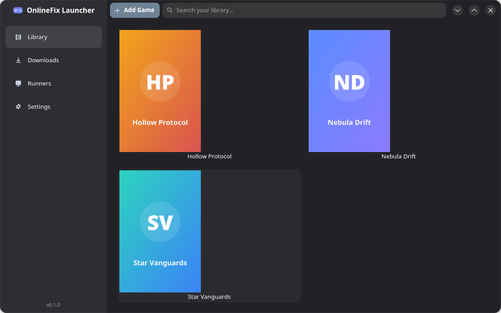
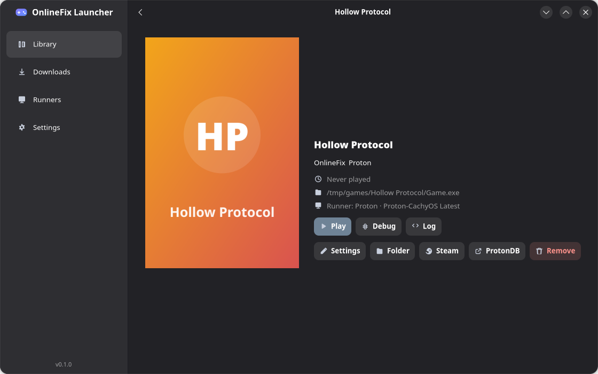
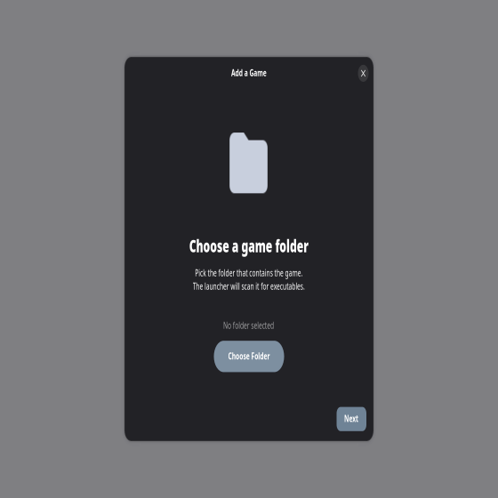
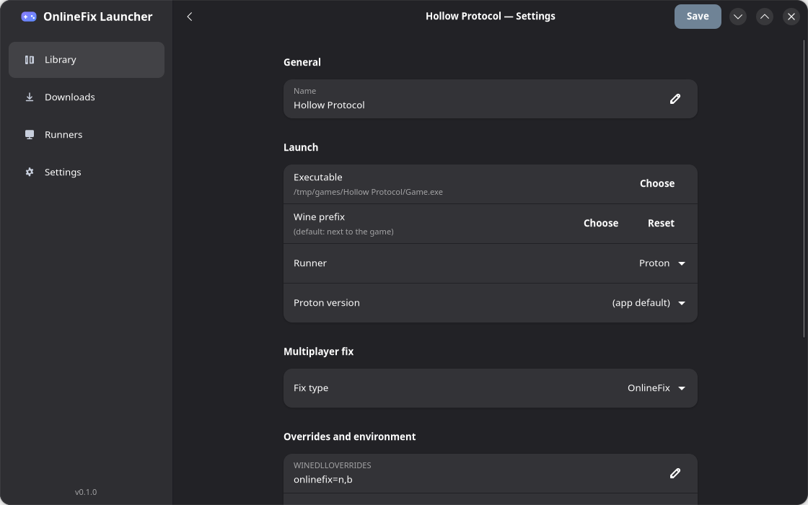
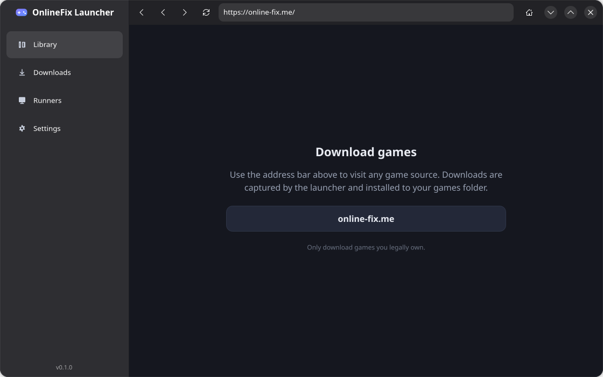
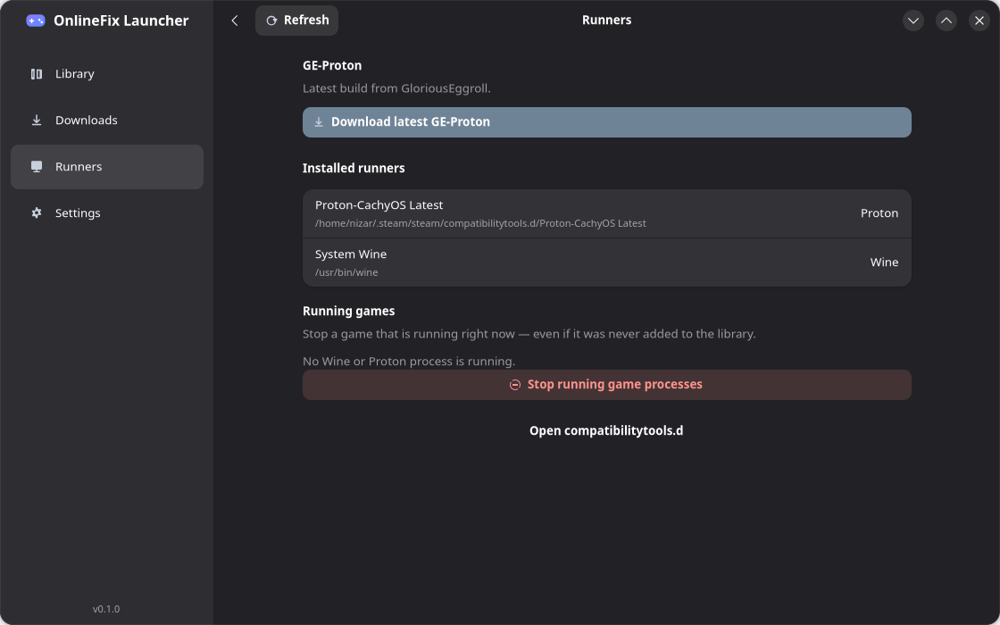
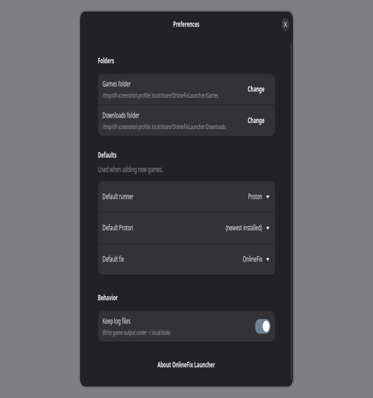

<div align="center">


# OnlineFix Launcher

**A modern, native Linux launcher for playing your own games with community multiplayer fixes.**

Built with **GTK4 + libadwaita** in pure Python — no Electron, no web UI, no runtime to compile.

[](https://www.python.org/)
[](https://gtk.org/)
[](LICENSE)
[]()
[](https://github.com/nizar2004/OnlineFix-Launcher)

[Install](#-installation) · [Features](#-features) · [Screenshots](#-screenshots) · [Command line](#-command-line) · [Troubleshooting](#-troubleshooting)

</div>

---

## ✨ Highlights

| | |
|---|---|
| 🗂️ **Library** | A clean, searchable grid of every game you added — with cover art pulled automatically from Steam. |
| 🌐 **Built-in browser** | Download games without leaving the app. A real WebKitGTK browser with a download manager built in. |
| 📦 **Install from download** | Download an archive, click **Install…**, pick a folder — the launcher extracts it and adds the game to your library automatically. |
| 🛠️ **Per-game control** | Executable, Wine prefix, Proton version, fix type, `WINEDLLOVERRIDES`, extra environment variables, shortcuts — all editable per game. |
| 🧯 **Kill anything** | A global **Stop** button, a Runners-page killer and `--kill` / `--kill-all` flags end the running game and its whole process tree — even games the launcher never started. |
| 📜 **Live logs** | Watch the game's stdout/stderr in a built-in log viewer, with the ability to save it to a file. |
| 🎮 **Runners** | Detects every installed Proton and Wine build, and can download the latest **GE-Proton** for you. |
| 🌙 **Native dark UI** | Purpose-built libadwaita interface with a violet accent — fast, keyboard-friendly and tiny on resources. |

---

## 📦 Installation

The launcher is a single Python application. The installer takes care of the dependencies, the
application files, the desktop entry and the icon.

### One-liner (recommended)

```bash
curl -fsSL https://raw.githubusercontent.com/nizar2004/OnlineFix-Launcher/main/install.sh | bash
```

Then run it:

```bash
onlinefix-launcher
```

### System-wide installation

```bash
curl -fsSL https://raw.githubusercontent.com/nizar2004/OnlineFix-Launcher/main/install.sh | sudo bash -s -- --system
```

### Installer options

| Flag | Description |
|---|---|
| *(none)* | Install for the current user into `~/.local` (no root required). |
| `--user` | Same as above — explicit user install. |
| `--system` | Install into `/usr/local` and `/usr/share` (requires root). |
| `--no-deps` | Skip system package installation (dependencies must already be present). |
| `--uninstall` | Run the uninstaller instead of the installer. |
| `--help` | Show the help text. |

### Uninstall

```bash
# Keep your games and configuration
curl -fsSL https://raw.githubusercontent.com/nizar2004/OnlineFix-Launcher/main/uninstall.sh | bash

# Remove everything, including settings, covers, logs and game data
curl -fsSL https://raw.githubusercontent.com/nizar2004/OnlineFix-Launcher/main/uninstall.sh | bash -s -- --purge

# Also remove a system-wide installation
curl -fsSL https://raw.githubusercontent.com/nizar2004/OnlineFix-Launcher/main/uninstall.sh | bash -s -- --purge --system
```

| Flag | Description |
|---|---|
| `--purge` | Also delete configuration, cache, logs, covers, downloads and game folders. |
| `--system` | Also remove the system-wide installation in `/usr/local` and `/usr/share`. |
| `--yes` | Do not ask for confirmation (useful for scripts). |
| `--help` | Show the help text. |

### Manual installation

```bash
git clone https://github.com/nizar2004/OnlineFix-Launcher.git
cd OnlineFix-Launcher
python3 main.py
```

---

## 📋 Requirements

The launcher needs a fairly modern desktop Linux:

| Component | Minimum | Notes |
|---|---|---|
| Python | 3.10 | `python3` |
| PyGObject | 3.42 | `python3-gobject` / `python-gobject` |
| GTK | 4.10 | `gtk4` |
| libadwaita | 1.4 | `libadwaita` — 1.10 recommended |
| WebKitGTK | 6.0 | `webkit2gtk-6.0` — only needed for the built-in browser |

The installer detects your package manager and installs the right packages:

| Distribution | Packages |
|---|---|
| Arch | `python-gobject gtk4 libadwaita webkit2gtk-6.0` |
| Debian / Ubuntu / Mint | `python3 python3-gi gir1.2-gtk-4.0 gir1.2-adw-1 libwebkit2gtk-6.0-4` |
| Fedora | `python3-gobject gtk4 libadwaita webkit2gtk6.0` |
| openSUSE | `python3-gobject gtk4 libadwaita webkit2gtk-6.0` |

**Optional:** `p7zip` / `unrar` / `bsdtar` enable extraction of `.zip`, `.rar` and `.7z`
downloads. Without them the launcher still runs — it just cannot unpack archives.

To run games you also need a runner:

* **Proton** — Steam's Proton builds, found in `~/.steam/root/compatibilitytools.d` and
  `~/.local/share/Steam/compatibilitytools.d`.
* **Wine** — any system `wine` installation.
* **GE-Proton** — the launcher can download the latest build for you from the *Runners* page.

---

## 🧩 Features

### Library

* Grid of game cards with cover art, name and play state.
* Instant search as you type.
* Empty-state screen that points you to the add-game wizard.
* Covers are fetched automatically from the Steam store by game name; you can also set one manually.

### Adding a game

A guided three-step wizard:

1. **Pick the folder** that contains the game.
2. **Pick the executable** — every `.exe` inside the folder is listed, the largest one is
   suggested, and the game name is pre-filled from the file name.
3. **Finish** — choose the multiplayer fix type, the runner and an optional cover.
   The game is added to the library, the desktop shortcut is created and the cover is downloaded.

### Game page

| Action | What it does |
|---|---|
| **Play** | Launches the game with the configured runner, fix and environment. |
| **Stop** | Kills the running game (wineserver shutdown + full process-tree kill). |
| **Debug** | Same as *Play* but with `PROTON_LOG=1` / `WINEDEBUG` enabled for troubleshooting. |
| **Log** | Opens the live log window with the game's output. |
| **Settings** | Opens the per-game settings page. |
| **Folder** | Opens the game folder in your file manager. |
| **Steam** | Opens the game's Steam store page. |
| **ProtonDB** | Opens the compatibility report on ProtonDB. |
| **Remove** | Removes the game from the library (your files are kept). |

### Game settings

* **Name**, **executable** and **Wine prefix** (with a *Reset* button back to the default
  `Prefix` folder next to the game).
* **Runner**: Proton or plain Wine, plus a specific Proton version.
* **Multiplayer fix**: `OnlineFix`, `FreeTP`, `Custom` or `None`. Choosing a preset fills in the
  matching `WINEDLLOVERRIDES` value, and you can always edit it by hand.
* **Extra environment variables** — e.g. `DXVK_HUD=1`, `PROTON_ENABLE_NVAPI=1`.
* **Steam App ID** — used for the cover, the store link and the ProtonDB lookup.
* **Shortcuts** — create a `.desktop` entry on your Desktop and/or in the application menu.

### Built-in browser & downloads

* Full WebKitGTK 6 browser embedded in the launcher: back, forward, reload, home and an
  address bar that doubles as a search box.
* Every download is captured by the launcher instead of the browser — progress bar, cancel
  button and a finished-download list.
* **Save to…** lets you pick where downloads land at any time.
* **Install…** on a finished download extracts the archive (`.zip`, `.rar`, `.7z`) into the
  folder you choose, detects the main executable and adds the game to your library — cover art
  and all.

### Runners

* Lists every Proton build and Wine installation detected on the system.
* **Download latest GE-Proton** fetches the newest release and extracts it into
  `~/.local/share/Steam/compatibilitytools.d`.
* **Running games** shows every Wine/Proton process that is alive right now — including
  games you started outside the launcher — and can stop them all with one confirmed click.
* One click opens `compatibilitytools.d` in your file manager.

### Settings

* **Games folder** and **Downloads folder** — the default install locations.
* **Defaults** — runner, Proton version and fix type used for newly added games.
* **Keep log files** — write the game output to `~/.local/state/OnlineFixLauncher/logs`.
* **About** dialog with version, license and links.

---

## 🖼️ Screenshots

### Library



### Game page



### Add a game



### Game settings



### Built-in browser & downloads



### Runners



### Application settings



---

## ⌨️ Command line

```bash
onlinefix-launcher                    # open the launcher
onlinefix-launcher --launch "Game"    # launch a game straight away
onlinefix-launcher --kill             # kill the game that is currently running
onlinefix-launcher --kill-all         # kill every running Wine/Proton process
onlinefix-launcher --help             # show all options
```

`--kill` works from a script, a keybinding or a panic button — it terminates the running game
**and every child process it spawned**, even when the launcher itself is already closed. The
PID of the running game is remembered on disk (`~/.local/state/OnlineFixLauncher/running.json`),
so any process can stop it. A PID-reuse check makes sure a recycled PID is never killed by
mistake.

`--kill-all` goes one step further: it scans the process table for Wine and Proton processes and
stops every one of them — including games you launched outside the launcher and never added to
the library. The same action is available in the app on the **Runners** page under
*Running games*.

---

## 🗂️ Where things are stored

| Path | Contents |
|---|---|
| `~/.config/OnlineFixLauncher/settings.json` | Application settings |
| `~/.config/OnlineFixLauncher/games.json` | Your library |
| `~/.cache/OnlineFixLauncher/covers/` | Downloaded cover art |
| `~/.local/state/OnlineFixLauncher/logs/` | Game logs |
| `~/.local/state/OnlineFixLauncher/running.json` | PID of the game that is currently running (used by `--kill`) |
| `~/.local/share/OnlineFixLauncher/Games/` | Default folder for installed games |
| `~/.local/share/OnlineFixLauncher/Downloads/` | Default download folder |
| `~/.config/Steam/compatibilitytools.d/` | GE-Proton and other Proton builds |

Everything is plain JSON — easy to back up, easy to inspect, easy to sync between machines.

---

## 🛠️ Troubleshooting

**The window is blank or the app crashes on start**
Run it from a terminal to see the error output:

```bash
python3 main.py
```

**"WebKit was imported without specifying a version"**
Install WebKitGTK 6.0 (`webkit2gtk-6.0` / `libwebkit2gtk-6.0-4`). The browser page needs it; the
rest of the launcher works without it.

**The game does not start**
* Check the runner on the game settings page — try *Wine* if *Proton* does not work.
* Open the **Log** page to see the actual error output.
* Make sure the Wine prefix is writable and that the executable path is correct.

**Multiplayer does not work**
* Set the fix type to **OnlineFix** (or the preset your release uses).
* Some games need `WINEDLLOVERRIDES` tweaks — they are editable in the game settings.

**A game is stuck and will not close**
Use the global **Stop** button in the library header, or run:

```bash
onlinefix-launcher --kill
```

**Nothing is extracted after installing a download**
Install `p7zip`, `unrar` or `bsdtar` so the launcher can unpack the archive.

---

## 🧑‍💻 Development

```bash
git clone https://github.com/nizar2004/OnlineFix-Launcher.git
cd OnlineFix-Launcher

# run from source
python3 main.py

# regenerate the screenshots in screenshots/
python3 tools/screenshot.py
```

### Project layout

```
OnlineFix-Launcher/
├── main.py                  # entry point
├── install.sh               # curl-friendly installer
├── uninstall.sh             # curl-friendly uninstaller
├── data/                    # application icon
├── screenshots/             # README images
├── tools/screenshot.py      # screenshot generator
└── oflauncher/
    ├── app.py               # Adw.Application, CLI flags
    ├── config.py            # XDG paths and JSON storage
    ├── models.py            # Game dataclass and fix presets
    ├── library.py           # game library
    ├── runner.py            # process launching, killing, playtime
    ├── proton.py            # Proton/Wine discovery, GE-Proton
    ├── steam.py             # Steam cover search and download
    ├── installer.py         # archive extraction
    ├── shortcuts.py         # .desktop entries
    ├── exeicon.py           # Windows executable icon extraction
    ├── icons.py             # inline SVG icons
    ├── theme.py             # dark theme and CSS
    └── ui/                  # GTK4 / libadwaita pages
```

---

## 📄 License

Released under the [MIT License](LICENSE).

## ⚖️ Legal

OnlineFix Launcher is an independent project and is **not affiliated with, endorsed by or
sponsored by OnlineFix**. It is a launcher for games **you already own**. Downloading and
running cracked or otherwise modified games may be illegal in your country — you are responsible
for complying with the laws that apply to you.

---

<div align="center">

Made with ❤️ by [**nizar2004**](https://github.com/nizar2004)

</div>
